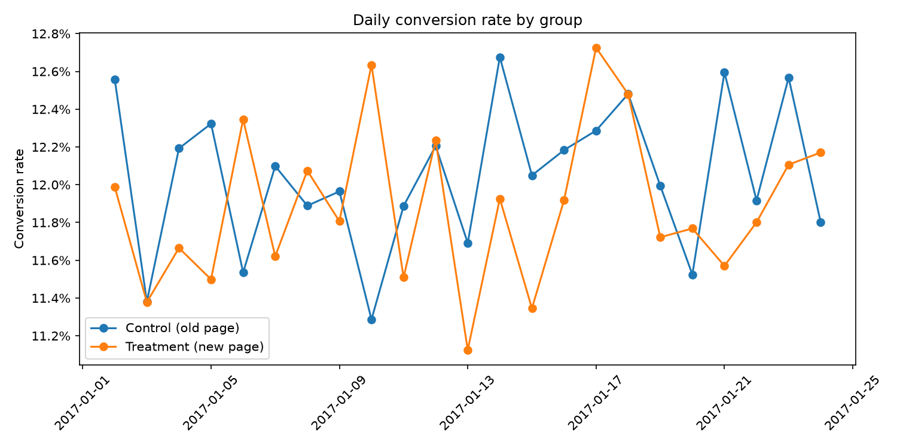

# Landing Page A/B Test Analysis

**Recommendation: don't launch the new landing page.** Across ~290,000 users, the redesign converted at 11.88% vs. 12.04% for the original, a difference that isn't statistically significant (p = 0.19). The best realistic case is a gain of less than 0.1 points, well below what the test was powered to detect.

## The question

An e-commerce company tested a redesigned landing page against its current one. Users were randomly assigned to see either the old page (control) or the new page (treatment) over 23 days. The goal: decide whether the new page improves conversion enough to launch.

## Approach

1. **Data cleaning.** Found 3,893 rows where a user's assigned group didn't match the page they saw, caused by a logging issue that also created duplicate user records. Dropped the mismatched rows (~1.3%, evenly split between groups) and kept one record per user.
2. **Experiment health checks.** Before looking at results, confirmed the test was trustworthy:
   - *Sample ratio mismatch:* chi-square goodness-of-fit on group sizes, p = 0.95, so the 50/50 split held.
   - *Country balance:* chi-square test of independence between group and country, p = 0.41, so both groups had the same mix of US, UK, and Canadian users.
3. **Power analysis.** Calculated the minimum detectable effect: with ~145,000 users per group, the test could reliably detect a lift of 0.34 points (12.04% → 12.38%) at 80% power.
4. **Main test.** Two-sided, two-proportion z-test with a 95% confidence interval for the difference.
5. **Segment checks.** Repeated the test by country with a Bonferroni correction for multiple comparisons, and plotted daily conversion to look for novelty effects or change aversion.

## Results

| | Control (old page) | Treatment (new page) |
|---|---|---|
| Users | 145,274 | 145,310 |
| Conversion rate | 12.04% | 11.88% |

- **Difference:** −0.16 points (z = −1.31, p = 0.19)
- **95% CI:** [−0.39, +0.08] points

The confidence interval includes zero, and its upper bound is far below the 0.34-point minimum detectable effect. In other words, the test can rule out any meaningful improvement from the new page.

**By country** (Bonferroni-corrected cutoff = 0.0167): no country showed a significant effect. The UK leaned slightly positive and the US and Canada slightly negative, but all three confidence intervals cross zero.

**Over time:** daily conversion rates crossed back and forth throughout the test with no sign of an early boost or dip that faded.



## Recommendation

Keep the old page. Launching the redesign would add cost with no evidence of benefit, and the point estimate leans slightly negative. A better next step is to test individual elements of the new page (headline, call-to-action, layout) separately to see whether any single change helps.

## Limitations

- The test ran 23 days. Daily data is noisy (~6,300 users per group per day), so the trend check can rule out a strong time effect but not a subtle one.
- Only conversion was measured. Effects on order value, engagement, or return visits aren't captured.
- The tracking bug behind the mismatched rows should be fixed before future tests.

## Tools

Python (pandas, SciPy, statsmodels, matplotlib) in a Jupyter notebook.

## Run it yourself

```bash
git clone https://github.com/ZackSmith16/landing-page-ab-test-analysis.git
cd landing-page-ab-test-analysis
python3 -m venv .venv
source .venv/bin/activate
pip install -r requirements.txt
```

Download the data as described in [`data/README.md`](data/README.md), then open `notebooks/ab_test_analysis.ipynb`.

## Repo structure

```
├── data/          # Raw data (not committed; see data/README.md)
├── figures/       # Charts used in this README
├── notebooks/     # Full analysis
└── requirements.txt
```

## Data source

Udacity Data Analyst Nanodegree, "Analyze A/B Test Results" project. Copy obtained from https://github.com/igorstojanovic91/udacity-a-b-test